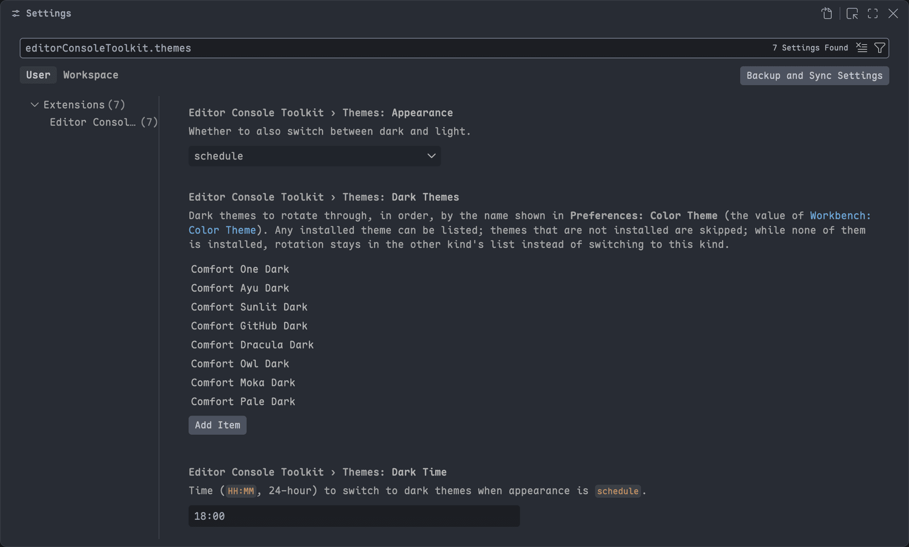

# Editor Console Toolkit

[](https://marketplace.visualstudio.com/items?itemName=HeavenSky.editor-console-toolkit)
[](https://marketplace.visualstudio.com/items?itemName=HeavenSky.editor-console-toolkit)
[](./LICENSE.txt)

**English** · [简体中文](./README.zh-cn.md)

Four everyday chores, one extension, zero runtime dependencies.

| | What it does | Where you use it |
| --- | --- | --- |
| **Console Toolkit** | Insert a debug log for whatever is under your cursor, then toggle it — or every log in the file — back off. 15 languages. | Command Palette, `Alt+L` |
| **Port Toolkit** | See which processes hold your local ports, tell them apart by where they were started, and terminate several at once. | Activity Bar |
| **Checksum Toolkit** | Silence the "installation appears to be corrupt" warning after you patch the editor's own files, and put it back when you want. | Command Palette |
| **Theme Toolkit** | Rotate your color theme through lists you choose, switching dark and light by time of day or your system appearance. | Settings, Command Palette |

UI in English and 简体中文, following your VS Code display language.

---

## Install

- **VS Code** — search `Editor Console Toolkit` in the Extensions view, or run `ext install HeavenSky.editor-console-toolkit` in the Command Palette.
- **Other VS Code–compatible editors** — download the `.vsix` from the [latest GitHub release](https://github.com/HeavenSky/editor-console-toolkit/releases) and run **Extensions: Install from VSIX…**.

### Requirements

VS Code `1.101.0` or newer. Nothing else to install: there are no bundled dependencies, nothing is downloaded at runtime, and Port Toolkit reads ports through tooling that already ships with macOS, Linux and Windows.

Checksum Toolkit additionally needs write access to the editor's own installation folder. Where it does not have that — typically Windows and Linux — it hands you a one-line command to run yourself instead of asking for your password.

---

## Quick start

**Log a variable.** Put the cursor on it and press `Alt+L` (`Option+L` on macOS):

```js
const user = getUser();
console.log('🎯🎯🎯 [DEBUG] user:', user); // ect:v1
```

**Clean up before committing.** Run **Console Toolkit: Toggle All Console Logs** to comment out every log the extension generated in the file — run it again to bring them back. Nothing is ever deleted.

**Free up a port.** Click the **Port Toolkit** icon in the Activity Bar, find the row with the `this workspace` marker, tick it and hit the 🗑 button in the view's title bar.

**Silence "installation appears to be corrupt".** After patching the editor's own files, run **Checksum Toolkit: Fix Checksums**, then quit the editor completely and start it again.

---

## Console Toolkit


### Commands

Type `Console Toolkit` in the Command Palette to find all three.

| Command | ID | Keybinding |
| --- | --- | --- |
| Insert Console Log | `editorConsoleToolkit.insertConsoleLog` | `Alt+L` |
| Toggle Console Log | `editorConsoleToolkit.toggleConsoleLog` | — |
| Toggle All Console Logs | `editorConsoleToolkit.toggleAllConsoleLogs` | — |

**Insert Console Log** writes a log for the current target. Where it lands depends on what the cursor is on:

| Cursor is on | The log goes |
| --- | --- |
| a line that opens a block — a function signature, an `if` / `for` head, a callback body | **inside the block**, as its first statement, indented like the rest of the block |
| a line that opens a block that cannot hold statements — `switch`, `class`, Rust's `match` or `impl` | on the line **before** that statement, where the value has already been evaluated |
| anything else | after the enclosing statement, however many lines it spans |

Running it twice does nothing the second time.

**Toggle Console Log** inserts the log if it is missing and removes it if it is already there. It also works with the cursor on the log line itself, which is the quickest way to delete one.

**Toggle All Console Logs** comments out every generated log in the file, and uncomments them next time:

```js
// before
const user = getUser();
console.log('🎯🎯🎯 [DEBUG] user:', user); // ect:v1

// after one run
const user = getUser();
// console.log('🎯🎯🎯 [DEBUG] user:', user); // ect:v1
```


If some logs are commented and others are not, the first run comments out the rest so the file ends up consistent. If the file has no generated logs, it says so and changes nothing.

### What gets logged

The target is your selection when you have one (single line only), otherwise the expression under the cursor.

Property chains are absorbed to the left: with the cursor on `name` in `user.profile.name` you log `user.profile.name`; with the cursor on `user` you log `user`.

Multi-cursor works. Everything one invocation changes is a **single undo step**, the document is never saved and never formatted, and no line other than the log itself is touched.

### Keybindings

Only **Insert Console Log** ships with a default binding, guarded by `editorTextFocus && !editorReadonly` so it never fires outside a writable editor. The other two are deliberately left unbound so nothing collides with your setup.

Bind them yourself in `keybindings.json` — and rebind or remove `Alt+L` the same way:

```json
[
  {
    "key": "ctrl+alt+shift+l",
    "command": "editorConsoleToolkit.toggleConsoleLog",
    "when": "editorTextFocus && !editorReadonly"
  },
  {
    "key": "ctrl+alt+shift+k",
    "command": "editorConsoleToolkit.toggleAllConsoleLogs",
    "when": "editorTextFocus && !editorReadonly"
  },
  {
    "key": "alt+l",
    "command": "-editorConsoleToolkit.insertConsoleLog"
  }
]
```

### Setting

| Setting | Type | Default | Scope |
| --- | --- | --- | --- |
| `editorConsoleToolkit.prefix` | `string` | `🎯🎯🎯 [DEBUG]` | `language-overridable` |

The prefix goes into the generated message so your output is easy to spot and easy to grep. It is read fresh on every invocation — changes take effect immediately, no window reload.

Because the scope is `language-overridable`, you can override it per workspace, per folder and per language:

```json
{
  "editorConsoleToolkit.prefix": "[debug]",
  "[python]": {
    "editorConsoleToolkit.prefix": "[py]"
  }
}
```

An empty prefix is valid and gives you `user:` instead of `🎯🎯🎯 [DEBUG] user:`. Control characters and line breaks are stripped silently.

### Supported languages

12 adapters covering 15 language IDs. No imports are ever added — Java and C# use fully qualified names for that reason.

| Language | Language IDs | Generated statement |
| --- | --- | --- |
| JavaScript / JSX / TypeScript / TSX | `javascript`, `javascriptreact`, `typescript`, `typescriptreact` | `console.log('🎯🎯🎯 [DEBUG] user:', user);` |
| Python | `python` | `print('🎯🎯🎯 [DEBUG] user:', user)` |
| Java | `java` | `System.out.println("🎯🎯🎯 [DEBUG] user: " + String.valueOf(user));` |
| Kotlin | `kotlin` | `println("🎯🎯🎯 [DEBUG] user: ${user}")` |
| C# | `csharp` | `System.Console.WriteLine("🎯🎯🎯 [DEBUG] user: {0}", user);` |
| Lua | `lua` | `print("🎯🎯🎯 [DEBUG] user:", user)` |
| Ruby | `ruby` | `puts "🎯🎯🎯 [DEBUG] user: #{(user).inspect}"` |
| PHP | `php` | `var_dump('🎯🎯🎯 [DEBUG] user:', $user);` |
| Swift | `swift` | `print("🎯🎯🎯 [DEBUG] user:", user)` |
| Dart | `dart` | `print('🎯🎯🎯 [DEBUG] user: ${user}');` |
| Rust | `rust` | `println!("🎯🎯🎯 [DEBUG] user: {:?}", user);` |
| Elixir | `elixir` | `IO.inspect(user, label: "🎯🎯🎯 [DEBUG] user")` |

Per-language caveats:

- **Rust** — the value must implement `Debug`. If it does not, the code will not compile; change `{:?}` by hand or derive `Debug`.
- **Kotlin, Dart** — the expression sits inside string interpolation, so expressions containing `}` may need a manual fix.
- **JSX / TSX** — ordinary statement lines only. Nothing is inserted inside JSX markup.
- **Ruby, Elixir, Kotlin, Dart, C#, Rust** — characters in your prefix that mean something to the target language (`#`, `$`, `{`, `}`) are escaped for you.

### Why your own logs are safe

Every generated log carries a short trailing marker, using the target language's comment syntax:

```js
console.log('🎯🎯🎯 [DEBUG] user:', user); // ect:v1
```

```python
print('🎯🎯🎯 [DEBUG] user:', user) # ect:v1
```

That marker is the **only** thing that makes a line eligible for removal:

- Logs you wrote by hand are never removed, even if they look identical.
- The marker does not contain the prefix, so changing `editorConsoleToolkit.prefix` does not orphan logs you already inserted.
- Removal also requires the log to sit on the line immediately next to its anchor, so two logs for the same variable name in different places never get confused.

Ship your code with the markers gone — toggle them off, or search the workspace for `ect:v1`. The marker survives commenting, which is how **Toggle All Console Logs** finds and restores a log you commented out earlier.

### When nothing happens

The extension refuses to guess. It shows a warning and leaves the document untouched when:

- the selection spans more than one line;
- the statement has unbalanced brackets or an unterminated string, or runs longer than 50 lines;
- the cursor is inside a block comment or a multi-line string (a template literal, a Python triple-quoted string);
- the cursor is inside a comment;
- the cursor is inside a string literal;
- there is no expression under the cursor;
- the language is not supported yet.

Everything else gets inserted at one of the three places in the table above. When the syntax is ambiguous — a lone `{` whose meaning cannot be told apart, for instance — the log lands after the whole statement instead of inside the block: further out than you might like, but never syntactically broken. If a placement is not what you wanted, one undo takes it back.

---

## Port Toolkit

Click the **Port Toolkit** icon in the Activity Bar. The view lists every process listening on a local port — **one row per process, not one row per port**. The first row is always the search row:


```text
PORT TOOLKIT                                  🗑  ⧩  ⟳
  🔍 Search                for example 3000, node, ~/repo
  ☑ node                5173, 24678  ·  this workspace
      PID: 41802  ·  PPID: 41799  ·  sky
      Uptime: 12:33
      Working directory: ~/repo/web/apps/site
      Listening on: TCP 0.0.0.0:5173  ·  TCP 127.0.0.1:24678
      Command: node vite --host --port 5173
  ☑ node                3000  ·  this workspace
  ☐ java                8080
  🔒 Code Helper         6001  ·  the editor itself
```

A process holding several ports takes a single row, so **the number of rows you tick is always the number of processes that get terminated** — no double-counting, no surprises.

With a filter active, the search row shows what it is and how much it hides, and carries a ✕ to clear it:

```text
PORT TOOLKIT                                  🗑  ⧩  ⟳
  🔍 Search: 3000                       2 of 7 shown  ✕
  ☑ node                3000  ·  this workspace
  ☐ java                30001
```

### Telling processes apart

The `this workspace` marker appears when the process was started from inside one of your open workspace folders. That marker is the whole point of the view: when three `node` processes are listening, the working directory is what tells you which one is yours.

Expand a row — or hover it — for the rest:

| Field | Meaning |
| --- | --- |
| PID, PPID | process and parent process IDs |
| User | the process owner |
| Uptime | how long it has been running |
| Working directory | where it was started from, abbreviated to `~` under your home directory |
| Listening on | every endpoint, with protocol and bind address |
| Command | the full command line, never truncated |

### Commands

Type `Port Toolkit` in the Command Palette. The view's title bar carries the same actions. **No default keybindings** are contributed for any of them.

| Command | ID | Where |
| --- | --- | --- |
| Kill Checked Processes | `editorConsoleToolkit.ports.killSelected` | 🗑 title bar, palette |
| Toggle System Processes | `editorConsoleToolkit.ports.toggleSystemProcesses` | ⧩ title bar, palette |
| Refresh Ports | `editorConsoleToolkit.ports.refresh` | ⟳ title bar, palette |
| Search Ports | `editorConsoleToolkit.ports.search` | click the search row, palette |
| Clear Port Search | `editorConsoleToolkit.ports.clearSearch` | ✕ on the search row |
| Kill Process | `editorConsoleToolkit.ports.killOne` | row hover |

**Terminating in batches.** Tick as many rows as you like, then run **Kill Checked Processes**. You get a modal confirmation listing exactly what will be terminated, and afterwards a summary of how many actually went down. Ticked rows survive the automatic refresh, so you can take your time.

**Searching** matches process name, full command line, PID, working directory and any port number — `5173`, `vite` and `~/repo/web` all work.

Click the search row to type. The list narrows as you type (after a short pause), **Enter** keeps the filter and **Esc** puts it back the way it was before you opened the box. While a filter is active the search row shows the term and the match count, and the ✕ next to it clears the filter; with no filter there is nothing to clear, so the ✕ is not there at all.

One thing to know: **the filter does not clear your ticks.** A process you ticked before filtering is still ticked even when the filter hides its row, so **Kill Checked Processes** will terminate it. The confirmation dialog always lists every process that is about to go down, so read it if you have been filtering.

### How termination works

The process is asked to shut down first (`SIGTERM`), and only force-killed (`SIGKILL`) if it is still alive after `killTimeout`. A dev server that handles shutdown gets its chance to close sockets and clean up temporary files.

Four things it will not do:

- **It will not touch child processes.** Only the process on the row you ticked.
- **It will not terminate a process whose command line changed.** The command line is re-read immediately before anything is sent. Between ticking a row and confirming, a process can exit and its PID be reused by something else — if the command line no longer matches, that row is skipped and reported as skipped rather than killed blindly.
- **It can never terminate your editor.** The editor's own processes get a lock icon, no checkbox and no terminate action. This is worked out from the live process tree, so it holds for any VS Code–compatible editor.
- **It will not try to elevate.** Processes owned by another user are listed and labelled, but cannot be terminated.

### Refresh behaviour

The view rescans every `refreshInterval` milliseconds **only while it is visible**. Switch to another Activity Bar icon and the timer stops — there is no background scanning when you are not looking at it. Set `refreshInterval` to `0` to refresh only on demand.

A scan costs the same whether you have two ports open or fifty. If one fails, the view shows a single error row rather than raising a notification — with polling, one notification per cycle would bury the editor.

### Settings

| Setting | Type | Default | What it does |
| --- | --- | --- | --- |
| `editorConsoleToolkit.ports.refreshInterval` | `number` | `5000` | Rescan interval in ms while the view is visible. `0` disables auto-refresh. |
| `editorConsoleToolkit.ports.killTimeout` | `number` | `3000` | How long to wait after `SIGTERM` before escalating to `SIGKILL`. |
| `editorConsoleToolkit.ports.hideSystemProcesses` | `boolean` | `true` | Hide system processes. |
| `editorConsoleToolkit.ports.systemPortMax` | `number` | `1024` | Highest port number treated as a system port. |
| `editorConsoleToolkit.ports.includeUdp` | `boolean` | `false` | Also list UDP endpoints, not just TCP listeners. |

A process counts as a system process when it was started from a system directory **or** when every port it listens on is at or below `systemPortMax`. One port above the threshold is enough to keep it visible, so a system process squatting on `8080` is never silently hidden.

### Platform support

macOS, Linux and Windows.

> ⚠️ Only macOS has been verified on real hardware so far. Linux and Windows support is implemented and covered by tests, but **has not yet been run on a real Linux or Windows machine** — please report anything that looks wrong.

When the system will not say which process owns a socket — on Linux this happens without root — the row is still listed with the port visible and the owner marked unknown, rather than being dropped. You at least learn that the port is taken.

---

## Checksum Toolkit

Patch VS Code's own files — a CSS/JS injection, a UI tweak — and the next start greets you with **"Your installation appears to be corrupt"** and `[Unsupported]` in the title bar: the checksums recorded in `product.json` no longer match the files on disk. This feature area recalculates them.


### Commands

| Command | ID |
| --- | --- |
| Fix Checksums | `editorConsoleToolkit.checksums.apply` |
| Restore Checksums | `editorConsoleToolkit.checksums.restore` |

Neither ships with a default keybinding.

### How it works

**Fix Checksums** reads `product.json` from the running editor's installation folder, recomputes the SHA-256 of every file listed under `checksums`, and writes back only the entries that actually differ. Entries whose file is missing from disk are skipped and reported instead of aborting the run. If nothing differs, nothing is written at all.

Before the first write it **copies** `product.json` to `product.json.ect-orig.<version>` beside it. The new content goes to a temporary file in the same folder and is then renamed over `product.json`, so an interrupted run can never leave you with a truncated or missing `product.json` — which would be an editor that no longer starts.

**Restore Checksums** writes that backup back, and only then deletes it.

> **Restore returns you to the state before this extension's first fix — not to a factory-fresh `product.json`.** If checksums had already been patched by something else, that is what the backup captured. With no backup left, the way back is reinstalling the editor; your settings and extensions live elsewhere and survive that.

Either command requires a **full quit and restart** of the editor afterwards. Reloading the window is not enough.

Running either one also clears out backups left for *other* editor versions — only files this extension wrote itself (`product.json.ect-orig.*`), never anything else in that folder.

### When the installation is not writable

On Windows and Linux the installation usually sits where only an administrator can write. **This extension never elevates privileges.** It writes the fixed `product.json` into your temporary folder and hands you the single command that finishes the job:

```sh
sudo cp "…/product.json" "…/product.json.ect-orig.1.132.0" && sudo cp "/tmp/editor-console-toolkit/product.json" "…/product.json"
```

The notification carries a **Copy command** button, so it goes straight to the clipboard. On Windows it is the same command spelled `copy /Y …`, to be run from an elevated terminal.

### Scope and platform support

macOS, Linux and Windows, and any VS Code–compatible editor with the same installation layout (Cursor, VSCodium, Windsurf) — the folder comes from the running editor rather than from a guess.

> ⚠️ Verified on real hardware on macOS only, same as Port Toolkit.

The commands refuse to run, with the reason shown, in a Remote (SSH, WSL, container) window or on the web: there the extension host is not the machine holding the editor in front of you.

**Patching the core files is not this extension's job** — it only stops the editor complaining about a patch you already made. An editor upgrade replaces `product.json`, so run **Fix Checksums** again after one. Modifying core files is unsupported by the vendor; using this means you know what you are doing.

---

## Theme Toolkit

Rotates your color theme through lists you choose — for example every hour on the hour — and switches between a dark list and a light list by time of day or by your operating system's appearance. The lists can name **any installed theme**; out of the box they hold the sixteen themes of [Editor Comfort Theme](https://marketplace.visualstudio.com/items?itemName=HeavenSky.editor-comfort-theme), and nothing happens until the current theme is one of them.



### Commands

| Command | ID |
| --- | --- |
| Next Theme | `editorConsoleToolkit.themes.next` |

Moves to the next installed theme of the same kind right away. It ships without a default keybinding.

### Settings

| Setting | Type | Default | What it does |
| --- | --- | --- | --- |
| `editorConsoleToolkit.themes.enabled` | `boolean` | `true` | Turn rotation on or off. |
| `editorConsoleToolkit.themes.interval` | `number` | `60` | Minutes between rotations, aligned to the local clock. Below `30` means no rotation (only dark/light switching); above `20160` (two weeks) counts as two weeks. |
| `editorConsoleToolkit.themes.darkThemes` | `string[]` | the eight Comfort dark themes | Dark themes to rotate through, in order, by the name shown in **Preferences: Color Theme**. |
| `editorConsoleToolkit.themes.lightThemes` | `string[]` | the eight Comfort light themes | Light themes to rotate through, in order. |
| `editorConsoleToolkit.themes.appearance` | `string` | `schedule` | `schedule` switches dark/light at `lightTime` / `darkTime`; `system` follows the OS appearance (macOS, Windows, and Linux via the XDG desktop portal, GNOME or KDE settings), rechecked every 10 minutes and when the window regains focus; `keep` stays dark or light. |
| `editorConsoleToolkit.themes.lightTime` | `string` | `09:00` | `schedule`: switch to the light list at this time. |
| `editorConsoleToolkit.themes.darkTime` | `string` | `18:00` | `schedule`: switch to the dark list at this time. |

### How it decides

- **Only themes in the lists are managed.** Pick a theme that is in neither list — from any extension or VS Code itself — and rotation pauses without changing a setting; pick one from the lists again and it resumes from there. Removing the current theme from the lists has the same effect.
- **Missing themes are skipped.** Before writing a theme, the extension checks that it is installed and otherwise takes the next installed theme in the list. When none in the list to switch to is installed, rotation stays on the current dark/light kind and keeps rotating through its own list, and switches over once one is installed — so listing only dark themes simply keeps rotating dark themes during the day.
- **Startup does not flash.** On load, if the current theme already has the wanted kind it is kept as the theme of the current period and later periods continue from it; only a wrong kind (dark in the morning, say) switches right away.
- **A theme you pick by hand** from the lists is kept until the next switch time, and rotation continues with the one after it.
- **One switch per period across windows.** Every window derives the same theme from the clock, and only the focused window keeps a timer; windows in the background sleep and catch up when focused again.
- **Workspace settings win.** Rotation only writes the user-level `workbench.colorTheme`. A window whose theme is set by workspace settings (`.vscode/settings.json`, or the `.code-workspace` file) keeps showing that theme, but still drives rotation of the user-level theme while focused; changing the workspace theme does not count as picking a theme, and **Next Theme** does nothing there. `window.autoDetectColorScheme` overrides `workbench.colorTheme`; turn it off to use this feature.
- **Remote windows are skipped**, because there the clock, time zone and system appearance belong to the remote machine; a local window does the switching.

---

## Privacy and performance

- **No telemetry, no network access.** Nothing about you or your code leaves your machine.
- **No runtime dependencies.** The extension ships as a single bundled file.
- **Console Toolkit is purely command-driven** — no listeners, no timers, no status bar item. It does nothing until you run one of its commands.
- **Port Toolkit only works while you are watching it.** Its scan timer exists only while its view is visible.
- **Theme Toolkit keeps one timer, in the focused window only.** It wakes at most every five minutes and reads the system appearance (only with `appearance` set to `system`) at a switch time, every 10 minutes, when the window regains focus (at most once per 15 seconds) or when its settings change; it does nothing in background or Remote windows.
- **Checksum Toolkit touches the disk only when you run it.** No startup scan, no elevation, and nothing is written outside the editor's own installation folder and your temporary folder.

These are not just promises: the build fails if a timer, listener or persistent-UI API ever appears in the console side of the codebase.

## Troubleshooting

| Symptom | Cause and fix |
| --- | --- |
| `Alt+L` does nothing | The binding requires `editorTextFocus && !editorReadonly`. Check for a conflict in **Keyboard Shortcuts** (search `alt+l`). |
| "Console Toolkit does not support this language yet" | The language has no adapter yet. See [Supported languages](#supported-languages) and the [Roadmap](#roadmap). |
| A log will not toggle off | It has no `ect:v1` marker, or it is no longer on the line immediately next to its anchor. Remove it by hand. |
| The ports view is empty | Everything listening may be filtered as a system process. Run **Toggle System Processes**, or lower `systemPortMax`. |
| A row says the process cannot be terminated | It is your editor, one of its own processes, or owned by another user. See [How termination works](#how-termination-works). |
| "Port scan failed" row | The system refused the port lookup. The row shows the reason it gave. |
| The port list looks stale | The view only refreshes while visible. Hit ⟳, or check that `refreshInterval` is not `0`. |
| "Installation appears to be corrupt" survives **Fix Checksums** | Reloading the window does not apply it — quit the editor completely and start it again. If it comes back later, an editor update rewrote `product.json`; run the command once more. |
| "No write access to the editor installation" | Expected on Windows and Linux. The fixed file is staged in your temporary folder; run the command from the notification (**Copy command**) in a terminal with administrator rights. |

## Roadmap

Console Toolkit language support ships in tiers, because each language needs its own handling to stay safe rather than one generic implementation.

- **Next up** — shell / zsh, PowerShell, Perl, Go, C, C++, Scala, Groovy, Clojure, R; Vue, Svelte and Astro through their `<script>` blocks; notebook cells.
- **Later** — SQL, which has no single logging construct across dialects and so will need an explicit dialect setting rather than a risky guess.

For Port Toolkit and Checksum Toolkit, the next step is verifying Linux and Windows on real machines — the port parsers and the not-writable-installation path are both implemented and tested, but only exercised for real on macOS.

## Development

```bash
npm ci
npm run check       # icon, manifest, l10n and template drift gates
npm run typecheck
npm test
npm run package     # build artifacts/<name>-<version>.vsix and assert its contents
npm run shots       # regenerate the README screenshots in media/screenshots/ (macOS, run by hand)
```

`npm run shots` opens a separate VS Code window with its own profile, demonstrates each feature and saves compressed screenshots to `media/screenshots/` (full-size originals go to `artifacts/shots/`). Leave the window alone while it runs. It is never part of packaging or release; rerun it by hand when the UI changes and commit the updated images with the README.

With npm 12, `npm ci` only accepts a lockfile resolved from `registry.npmjs.org`, and dependency install scripts (`esbuild`, `@vscode/vsce-sign`, `fsevents`) are skipped by default. None of them is needed to check, test or package; approve one with `npm install-scripts approve <package>` only if signing or publishing locally fails. CI uses the npm bundled with the Node version in `.nvmrc` and is not affected.

## Release notes

See [CHANGELOG.md](./CHANGELOG.md).

## License

[MIT](./LICENSE.txt)

Checksum Toolkit was written from scratch, but its behaviour is derived from [vscode-fix-checksums](https://github.com/RimuruChan/vscode-fix-checksums) — MIT © Jürg Lehni 2018, MIT © RimuruChan 2024. None of its code or dependencies is bundled here.
