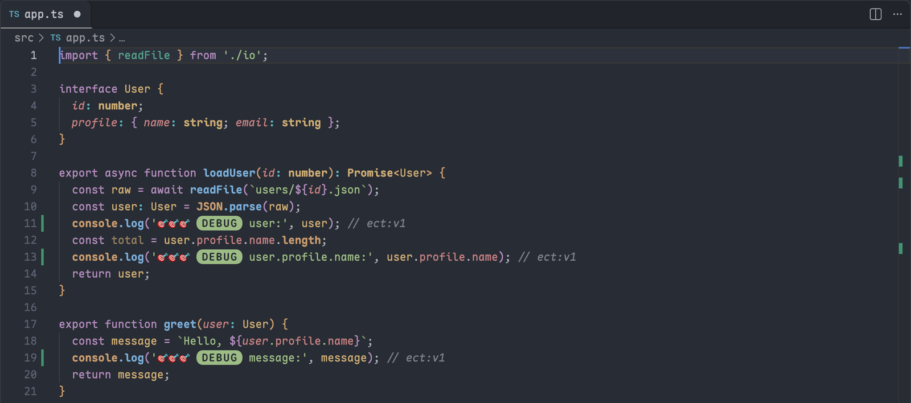
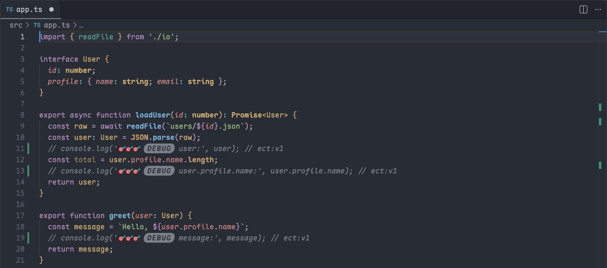
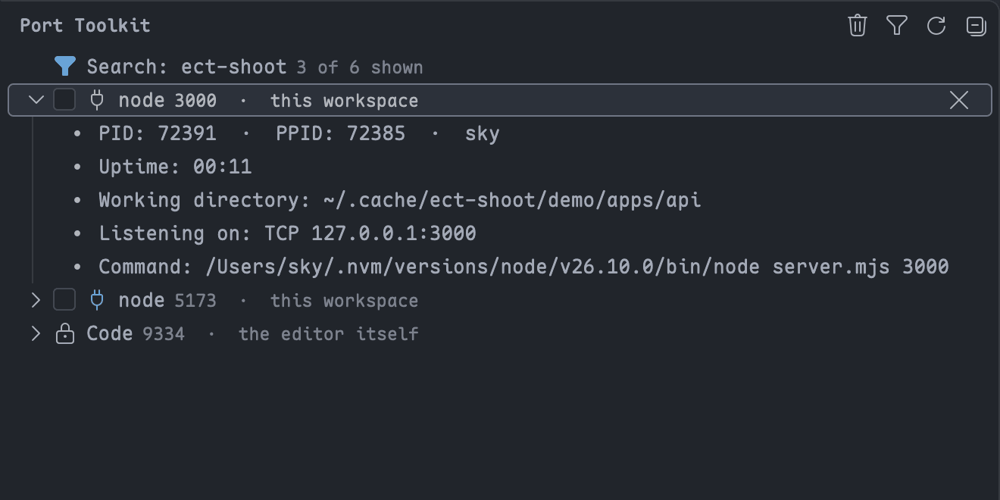
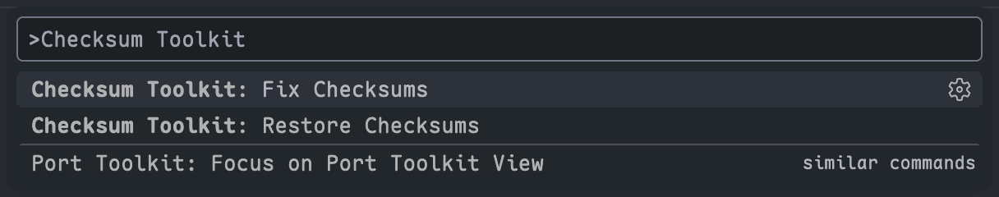
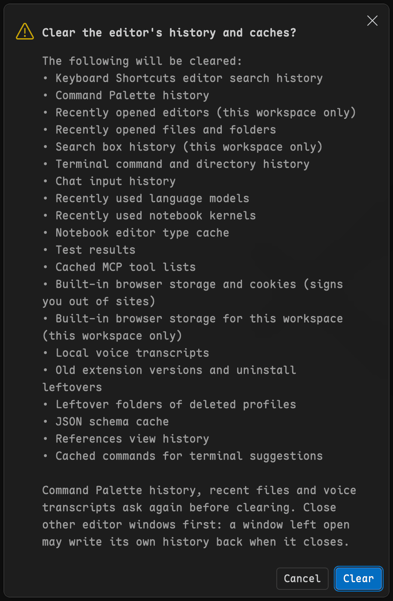

# Editor Console Toolkit

[English](../README.md) · **简体中文**

> 插件市场页只显示英文版 README；插件界面会跟随 VS Code 的显示语言切换为中文。

一个快捷键给光标处的表达式加上调试日志，提交前用一条命令把它们全部关掉；停掉占着开发端口的进程；消掉改过编辑器文件后出现的「安装似乎已损坏」警告；一次清掉编辑器的历史与缓存。

[](https://marketplace.visualstudio.com/items?itemName=HeavenSky.editor-console-toolkit)
[](https://marketplace.visualstudio.com/items?itemName=HeavenSky.editor-console-toolkit)
[](../LICENSE.txt)

这是一个 VS Code 插件，适合这几类开发者：习惯用打印语句调试的，本机同时跑好几个服务的，会改动或清理编辑器本身的。和代码片段不同，生成的日志会按当前语言的写法插到合适的位置，并带一个标记，删除或切换时只动带标记的那些，不碰你手写的。和在终端里用 `lsof`、`kill` 相比，端口视图直接列出每个进程的工作目录，不用对着 PID 猜哪个是你的。插件没有运行时依赖，自身也不发起任何网络请求。



## 快速开始

1. 从 [VS Code 插件市场](https://marketplace.visualstudio.com/items?itemName=HeavenSky.editor-console-toolkit)安装。其他兼容编辑器见[安装与更新](./docs/install.md)。
2. 把光标放在一个变量上，按 `Alt+L`（macOS 上是 `Option+L`），下一行就出现了可以直接运行的日志：

```js
const user = getUser();
console.log("🎯🎯🎯 [DEBUG] user:", user); // ect:v1
```

## 一键给光标处的表达式加日志

**日志会落在表达式已经有值的位置**：光标在函数签名或 `if` 条件行上时插进块内；块里不能直接放语句时（例如 `switch`），插在光标所在语句之前；其他情况插在整条语句之后。支持 15 种语言 ID，从 JavaScript、Python 到 Rust、Elixir，也支持多光标。每次执行只占一步撤销，不会保存或格式化文件。详见[插入与清理调试日志](./docs/console-logs.md)。

## 提交前把生成的日志全部关掉

执行「控制台工具箱：切换全部 Console 日志」，本插件在当前文件写下的日志会全部被注释掉，再执行一次就恢复。它只处理行尾带 `ect:v1` 标记的行，你自己写的 `console.log` 原样不动。



## 停掉占着端口的进程

在活动栏的端口工具箱视图里认出占着端口的进程，勾选要停的那几个，一次终止。视图按监听进程逐行列出，每行附带工作目录和完整命令行；同时跑着几个 `node` 时，看 `本工作区` 标记就能认出自己的那个。编辑器自身的进程无法勾选。详见[查找并终止占用端口的进程](./docs/ports.md)。



## 消掉「安装似乎已损坏」

改过编辑器自身的文件后，执行「校验和工具箱：修复校验和」，再完全重启编辑器，警告就消失了。它只重写 `product.json` 里的校验和，会留一份备份供「校验和工具箱：还原校验和」使用，也从不向你要密码。详见[修复安装已损坏警告](./docs/checksums.md)。



## 一次清掉编辑器的历史与缓存

执行「清理工具箱：清理历史与缓存」并确认清单，它会调用编辑器和已装扩展自带的清理命令，清掉命令面板记录、最近打开的文件、搜索与终端历史、内置浏览器存储等。清理命令面板记录、最近打开的文件和语音转写前还会再问一次；清掉内置浏览器存储会让你退出已登录的网站。



要删的是工作数据时，执行「清理工具箱：删除工作数据...」：先取消勾选想保留的项，再删除聊天会话、本地历史、云端的工作变更（Edit Sessions）或 Copilot 记忆，删除后无法恢复。详见[清理编辑器的历史与缓存](./docs/cleanup.md)。

## 不适合的场景

插入与切换日志暂不支持 Go、C、C++、shell，以及 Vue、Svelte 文件里的 `<script>` 块；端口、校验和、清理这三项功能不受所用语言限制。需要断点和监视表达式时，内置调试器更合适。端口视图与校验和命令目前只在 macOS 上实机验证过，校验和命令在远程窗口（SSH、WSL、容器）和网页版里会拒绝执行。

## 进一步阅读

- [使用文档](./docs/README.md)：完整用法、设置、故障排查与隐私说明。
- 命令与设置清单见插件市场页的 Feature Contributions 标签。
- [更新日志](./CHANGELOG.md)：各版本的变化。

## 许可证

[MIT](../LICENSE.txt)。校验和命令的行为参考了 [vscode-fix-checksums](https://github.com/RimuruChan/vscode-fix-checksums)（MIT © Jürg Lehni 2018，MIT © RimuruChan 2024），未包含其任何代码。
